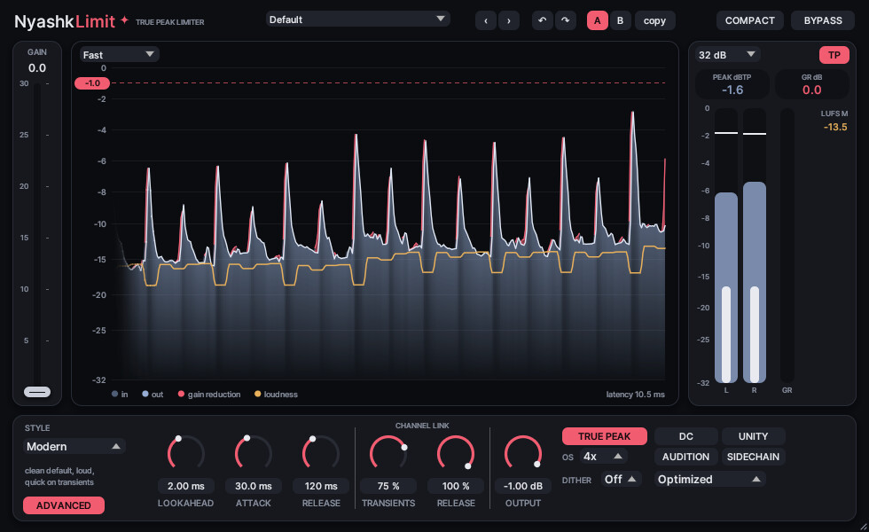
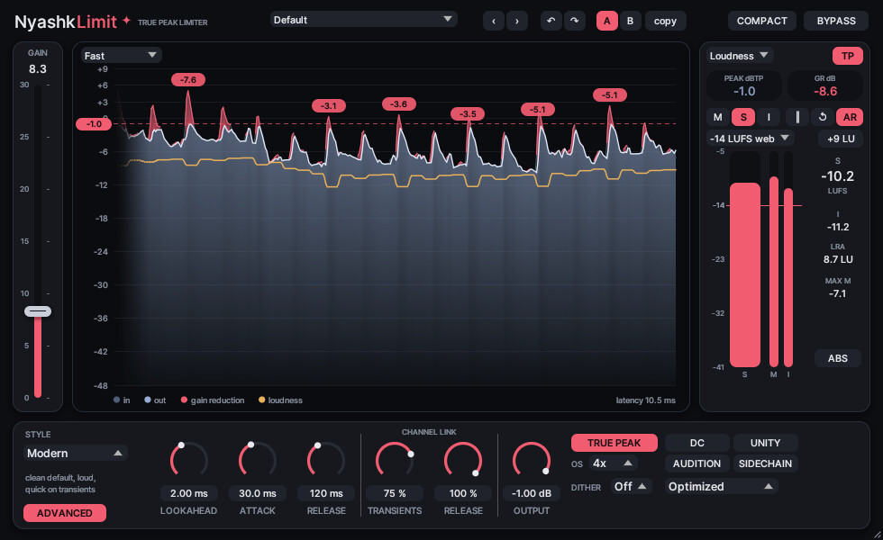
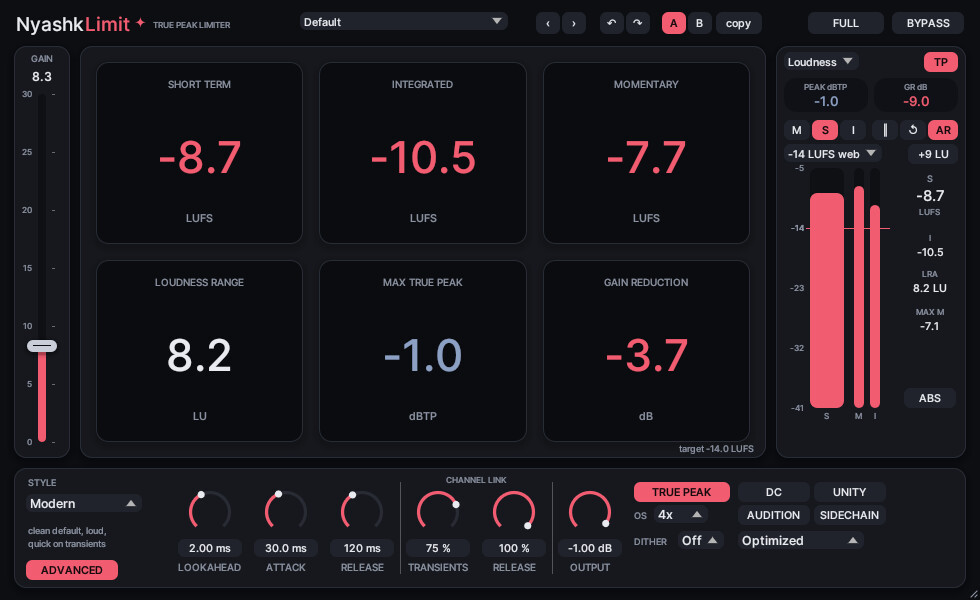

<div align="center">

# NyashkLimit

True-peak mastering limiter VST3 plugin: 8 limiting styles, up to 32x oversampling, loudness metering (BS.1770 / EBU R128) and dither.

[](https://github.com/xslimakx/NyashkLimit/actions/workflows/build.yml)
[](LICENSE)


[**Download**](https://github.com/xslimakx/NyashkLimit/releases/latest)

</div>

<p align="center"></p>

## Features
- **8 styles**: Transparent, Punchy, Dynamic, Allround, Aggressive, Modern, Bus, Safe.
- **Two-stage limiting**: a slow stage for the body, a fast look-ahead stage for transients, and a final true-peak guard.
- **Controls**: Lookahead (0–5 ms), Attack, Release, Channel Link for transients and release separately.
- **True peak limiting** (dBTP), oversampling Off / 2x / 4x / 8x / 16x / 32x.
- **Output**: ceiling with -0.1 / -1 / -2 dBTP delivery presets, Unity Gain to judge the sound at equal level, Audition to hear only what the limiter takes away.
- **Extras**: DC filter, external side chain, click-free latency-compensated bypass.
- **Dither** at 24 / 22 / 20 / 18 / 16 bits with three noise-shaping curves.
- **Big scrolling display**: input, output, gain reduction and loudness. Four modes (Fast, Slow, Slow Down, Infinite) and gain-reduction peak labels.
- **Meters**:
  - 16 / 32 / 48 dB, K-12 / K-14 / K-20 and Loudness scales.
  - Momentary / Short Term / Integrated, LRA, Max M/S.
  - Targets -9 / -14 / -23 / -24 LUFS or custom, absolute or relative.
  - Auto reset on play.
- **Compact view** with big numbers.
- **Workflow**: A/B, undo/redo, 20 presets for mastering, genres, tracks and delivery.

<p align="center"> </p>

## Install
Use the Nyashk Launcher, or unzip the `.vst3` bundle from the latest release into your VST3 folder.

## Build
```
cargo xtask bundle -p nyashklimit --release
cargo test --release -p nyashklimit
```
The bundle appears in `target/bundled/`. The tests check:
- the ceiling, sample peak and true peak (16x reference);
- transparency below the ceiling;
- exact latency;
- loudness against the BS.1770 / EBU Tech 3341–3342 reference values;
- dither, side chain, unity gain and audition.

`vendor/nih_plug` is NIH-plug (ISC licence) with one fix: side-chain bus layouts are now matched correctly by the VST3 wrapper.

## License
MIT

## Credits

UI font: [Inter](https://rsms.me/inter/) by Rasmus Andersson, SIL Open Font License 1.1 (`plugins/nyashklimit/src/fonts/Inter-LICENSE.txt`).
